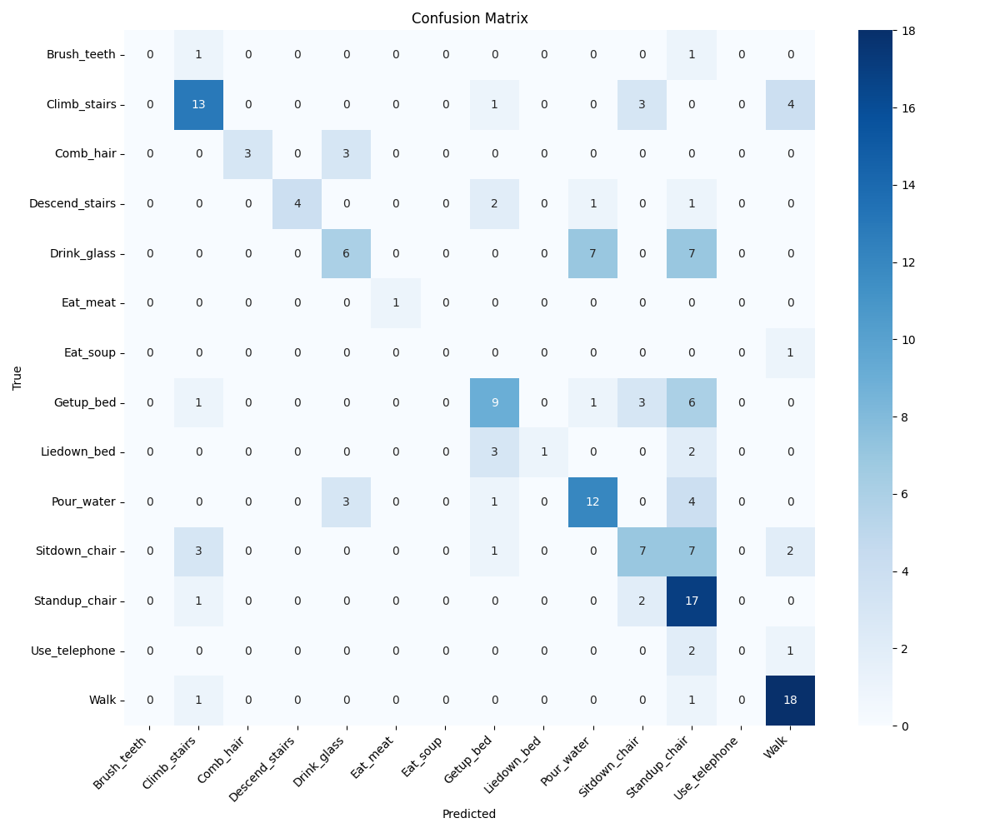

# Activity Recognition with Hierarchical k-means and Random Forest

Classifies 14 activities of daily life (e.g. walking, climbing stairs, drinking from a glass) from wrist-worn accelerometer recordings.

**Dataset:** [Dataset for ADL Recognition with Wrist-worn Accelerometer (HMP)](https://archive.ics.uci.edu/dataset/283/dataset+for+adl+recognition+with+wrist+worn+accelerometer), UCI. 839 recordings, 3-axis acceleration.

## Pipeline
1. **Load** the x, y, z acceleration for each recording.
2. **Segment** each recording into fixed-length windows (default 32 samples), giving 13,519 segments.
3. **Hierarchical k-means:** cluster all segments into level-1 clusters, then split each into level-2 sub-clusters (default 40 × 12 = 480 clusters). This builds a "dictionary" of short motion patterns.
4. **Histogram features:** represent each recording as a normalised histogram of which motion patterns it contains.
5. **Random forest** classifier (100 trees, stratified 80/20 split), evaluated by accuracy and a confusion matrix.
6. **Parameter tuning:** 9 experiments over segment length (16, 32, 64) × cluster settings (20×6, 40×12, 60×18).

## Results
| Setting | Total clusters | Accuracy |
|---|---|---|
| Segment 32, 40 × 12 (default) | 480 | 54.17% |
| **Segment 16, 20 × 6 (best)** | **120** | **64.88%** |
| Segment 16, largest cluster setting | 1080 | 62.50% |

- **More clusters did not always help.** Going from 120 to 1080 clusters lowered accuracy, a sign of overfitting where the model learns noise instead of meaningful patterns.
- **Shorter segments (16) performed best,** because they capture finer motion without mixing several activities in one window.
- **Class imbalance mattered:** activities with very few recordings (e.g. Eat_soup, 3 samples) were rarely classified correctly. Similar motions were confused, such as Pour_water vs. Drink_glass and Sitdown_chair vs. Standup_chair.



*Confusion matrix for the default setting (segment length 32, 480 clusters).*

## Run
```bash
python adl_classifier.py   # prompts for the dataset path (default ./HMP_Dataset) and optional parameter tuning
```
